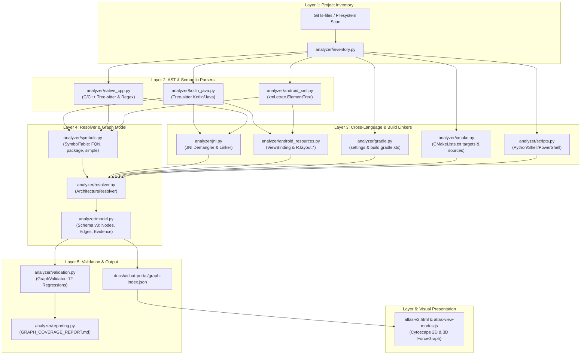

# AIchat Code Atlas — Dependency Analyzer Architecture Specification (v3)

**Version:** 3.0.0  
**Schema Version:** 3.0  
**Repository:** `KrakeCZ/AIchat-Android-Local-AI-Agent-`  
**Target Root:** `examples/llama.android/`  
**Portal Directory:** `docs/aichat-portal/`

---

## 1. System Overview and Core Principles

The **AIchat Code Atlas** is a high-fidelity, deterministic architecture dependency visualizer and static analysis portal for the offline Android AI agent application (`examples/llama.android/`). 

### Core Objectives
1. **Zero Android Source Modification:** The analyzer operates strictly as an offline static analysis engine. No runtime Kotlin, Java, C/C++, Gradle, or Manifest files are modified or contaminated with annotations or instrumentation.
2. **Deterministic 1:1 Coverage:** Every file, interface, Room DAO, JNI native bridge, Manifest component, layout view, and build script is mapped with verifiable, evidence-backed edges pointing directly to source lines.
3. **No Dangling Artifacts:** Zero orphan edges (edges connecting non-existent nodes) and zero invalid source line numbers.
4. **Idempotence and Performance:** Multi-pass AST parsing (with Tree-sitter and lexical fallback) completes in seconds, ensuring repeatable, automated CI verification on GitHub Actions.

---

## 2. Multi-Tier Analyzer Architecture



---

## 3. Detailed Component Specification

### 3.1. Inventory (`analyzer/inventory.py`)
- Discovers all source and configuration files tracked by git under `examples/llama.android/`.
- Classifies files by **Module** (`:app`, `:lib`, `:whisper`, `:root`), **Language** (`kotlin`, `java`, `cpp`, `header`, `xml`, `gradle_kts`, `cmake`, `python`, `shell`, `powershell`), and **Category** (`irismotion`, `audio`, `vision`, `gen`, `native`, `core`).
- Filters out non-source binary assets and external submodules (`/cpp/whisper.cpp/`, `/cpp/llama.cpp/`, `/cpp/ggml/`, build outputs).

### 3.2. Kotlin & Java AST Analyzer (`analyzer/kotlin_java.py`)
- **Dual-mode parsing:** Uses native Tree-sitter AST (`tree-sitter-kotlin`, `tree-sitter-java`) when available, backed by an exact lexical regex tokenizer with comment/string masking.
- **Extracted structures:**
  - Package declaration and package-scoped visibility
  - Imports: Exact imports, aliased imports (`import Foo as Bar`), and wildcard imports (`import pkg.*`)
  - Class, interface, and object declarations (`class`, `data class`, `interface`, `object`, `enum class`)
  - Supertypes and interface implementations (`class A : B(), C`)
  - Room DAO declarations (`@Dao`) and entity return types (`fun get(): List<Entity>`)
  - Method declarations, top-level functions, and property types
  - Class references (`Foo::class`, `Foo::class.java`)
  - JNI declarations (`external fun nativeMethod(...)`)

### 3.3. C/C++ Native Analyzer (`analyzer/native_cpp.py`)
- Parses first-party native C/C++ source and header files (`app/src/main/cpp/`, `lib/src/main/cpp/`, `whisper/src/main/cpp/`).
- Resolves `#include "..."` (quoted) and `#include <...>` (system/framework).
- Extracts JNI exported functions matching the JNI naming convention (`Java_<package>_<class>_<method>`).
- Extracts class and struct declarations.

### 3.4. JNI Demangler & Linker (`analyzer/jni.py`)
- Implements the Oracle JNI specification for symbol demangling:
  - Replaces `_1` escape sequences with `_`.
  - Strips overload signatures (`__...`).
  - Converts underscore hierarchy to Java package and class dot notation.
- Matches JNI exports against indexed Kotlin/Java `external fun` methods to establish bidirectional `jni_binding` edges with exact line evidence.

### 3.5. Android XML & Manifest Analyzer (`analyzer/android_xml.py`)
- Standard XML parsing via `xml.etree.ElementTree` without regex string masking distortion.
- Extracts `AndroidManifest.xml` components:
  - `<activity android:name="...">`
  - `<service android:name="...">` (including foreground service types)
  - `<receiver android:name="...">`
  - `<provider android:name="...">`
  - `<application android:name="...">`
- Resolves relative component names (`.ui.MainActivity` -> `com.example.llama.ui.MainActivity`).
- Parses Layout XML files:
  - Custom view class references (e.g. `<com.example.llama.agent.vision.camera.CameraGazePreview ...>`)
  - Layout inclusions (`<include layout="@layout/view_header" />`)
  - Navigation graph destinations

### 3.6. Android Resources & ViewBinding Linker (`analyzer/android_resources.py`)
- Builds an indexed registry of Android resources in `res/layout/`, `res/drawable/`, `res/menu/`, `res/xml/`.
- Implements ViewBinding class name conversion:
  - Converts CamelCase binding names (e.g. `ActivityMainBinding`, `FragmentOmniBinding`) to snake_case layout files (`activity_main.xml`, `fragment_omni.xml`).
- Resolves `R.layout.*` and `R.drawable.*` references in Kotlin/Java files to layout XML nodes.

### 3.7. Build System Linkers (`analyzer/gradle.py`, `analyzer/cmake.py`)
- **Gradle:**
  - Parses `settings.gradle.kts` to identify declared modules (`:app`, `:lib`, `:whisper`).
  - Parses `build.gradle.kts` files to extract inter-module project dependencies (`implementation(project(":lib"))`).
  - Resolves links to native CMake builds (`externalNativeBuild { cmake { path = file("...") } }`).
- **CMake:**
  - Parses `CMakeLists.txt` to identify declared libraries (`add_library(media_engine SHARED ...)`).
  - Resolves source file lists (`media_engine_jni.cpp`, `academic_yuv_jni.cpp`, `videogen_bridge.cpp`, `tae_decoder.cpp`).
  - Tracks linked library targets (`target_link_libraries`).

### 3.8. Architecture Resolver & Symbol Table (`analyzer/resolver.py`, `analyzer/symbols.py`)
- Multi-pass resolution coordinator:
  - **Pass 1:** Inventory indexing and node initialization.
  - **Pass 2:** AST parsing and SymbolTable population.
  - **Pass 3:** Cross-language and build system analysis.
  - **Pass 4:** Edge linking (direct imports, wildcard candidate filtering, same-package type matching, inheritance, JNI, ViewBinding, Manifest components, CMake sources, Gradle dependencies).
  - **Pass 5:** Deduplication and evidence consolidation.

### 3.9. Validation & Coverage Reporting (`analyzer/validation.py`, `analyzer/reporting.py`)
- Validates the complete graph against 12 critical regression test suites.
- Ensures zero orphan edges and zero invalid evidence lines.
- Generates `GRAPH_COVERAGE_REPORT.md` with baseline comparison metrics.

---

## 4. Graph Schema Specification (Schema v3)

### 4.1. Node Structure
```json
{
  "id": "examples/llama.android/app/src/main/java/com/example/llama/MainActivity.kt",
  "type": "file",
  "name": "MainActivity.kt",
  "category": "core",
  "path": "examples/llama.android/app/src/main/java/com/example/llama/MainActivity.kt",
  "package": "com.example.llama",
  "symbols": [
    {
      "name": "MainActivity",
      "kind": "class",
      "fqn": "com.example.llama.MainActivity",
      "line": 45,
      "is_top_level": true,
      "is_external": false
    }
  ],
  "search_symbols": ["MainActivity", "onCreate", "aiModelDao"],
  "properties": {
    "language": "kotlin",
    "module": ":app",
    "size_bytes": 10452,
    "is_test": false
  }
}
```

### 4.2. Edge Structure
```json
{
  "source": "examples/llama.android/app/src/main/AndroidManifest.xml",
  "target": "examples/llama.android/app/src/main/java/com/example/llama/MainActivity.kt",
  "type": "manifest_component",
  "confidence": "exact",
  "confidence_v3": "exact_syntax",
  "analyzer": "android_manifest",
  "evidence": [
    {
      "path": "examples/llama.android/app/src/main/AndroidManifest.xml",
      "line": 52,
      "snippet": "<activity android:name=\".MainActivity\" android:exported=\"true\">"
    }
  ]
}
```

### 4.3. Edge Types & Confidence Levels

| Edge Type | Confidence | Description |
|---|---|---|
| `import` | `exact_syntax` | Explicit Kotlin / Java import statement |
| `import_alias` | `exact_syntax` | Aliased import (`import A as B`) |
| `type_reference` | `resolved_static` | Statically resolved type in signatures, fields, or expressions |
| `inheritance` | `resolved_static` | Superclass or interface inheritance (`class A : B()`) |
| `interface_implementation`| `resolved_static` | Implemented interface (`class A : B`) |
| `jni_binding` | `exact_syntax` | C++ JNI export matched to Kotlin/Java `external fun` |
| `manifest_component` | `exact_syntax` | Android component declared in `AndroidManifest.xml` |
| `view_binding` | `resolved_static` | Activity/Fragment ViewBinding matched to layout XML |
| `resource_reference` | `resolved_static` | `R.layout.*` or `R.drawable.*` reference |
| `gradle_dependency` | `exact_syntax` | Inter-module Gradle `project(...)` dependency |
| `cmake_source` | `exact_syntax` | C++ source file declared in `CMakeLists.txt` |
| `cmake_link` | `exact_syntax` | Linked library target in `CMakeLists.txt` |
| `include` | `exact_syntax` | C/C++ `#include` directive |
| `same_package` | `candidate` | Unqualified reference to symbol within same package |
| `import_wildcard` | `candidate` | Reference resolved through wildcard import |

---

## 5. CLI Execution & Verification

### Running the Generator
```bash
# Build fresh graph-index.json and generate GRAPH_COVERAGE_REPORT.md:
python docs/aichat-portal/build_graph.py

# Verify that graph-index.json is up-to-date and all tests pass (for CI):
python docs/aichat-portal/build_graph.py --check
```

### Running the Test Suite
```bash
# Run all unit and regression test suites:
pytest docs/aichat-portal/tests -v
```

